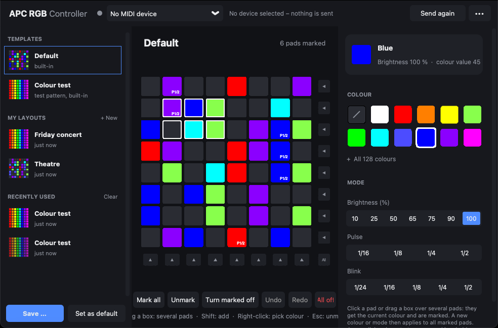

# APC RGB Controller

[English](README.md) · **Deutsch**

Farbsteuerung für die 64 RGB-Pads des **Akai APC mini mk2** – z. B. um das Pult passend zu den
Belegungen in **Obsidian Onyx** einzufärben. Version 2 mit neuer, schlichter Oberfläche.



Die Oberfläche gibt es auf Deutsch und Englisch (richtet sich nach der Systemsprache, umschaltbar im
•••-Menü).

## Download

Die neueste Version gibt es unter **[Releases](https://github.com/jonas-scl/akai-rgb-matrix-controller/releases/latest)** – ohne Installation und ohne Python:

| System | Download | Start |
| --- | --- | --- |
| Windows 10/11 | [APC-RGB-Controller-Windows.exe](https://github.com/jonas-scl/akai-rgb-matrix-controller/releases/latest/download/APC-RGB-Controller-Windows.exe) | Doppelklick. Beim ersten Start evtl. „Weitere Informationen → Trotzdem ausführen“ (Programm ist nicht signiert). |
| macOS mit Apple Silicon (M1 oder neuer) | [APC-RGB-Controller-macOS-AppleSilicon.zip](https://github.com/jonas-scl/akai-rgb-matrix-controller/releases/latest/download/APC-RGB-Controller-macOS-AppleSilicon.zip) | Entpacken, App in „Programme“ ziehen, dann **Rechtsklick → Öffnen** (nur beim ersten Mal, App ist nicht signiert). |
| macOS mit Intel-Prozessor | [APC-RGB-Controller-macOS-Intel.zip](https://github.com/jonas-scl/akai-rgb-matrix-controller/releases/latest/download/APC-RGB-Controller-macOS-Intel.zip) | wie oben |

Welcher Mac? Apfel-Menü → *Über diesen Mac*: „Chip: Apple M…“ = Apple Silicon,
„Prozessor: … Intel …“ = Intel.

Falls macOS meldet, die App sei „beschädigt“, im Terminal einmal ausführen:

```bash
xattr -cr "/Applications/APC RGB Controller.app"
```

Eigene Layouts und Einstellungen bleiben erhalten, wenn man das Programm durch eine neuere Version
ersetzt.

## Bedienung

* **Pad anklicken** → bekommt die aktuelle Farbe und wird markiert (weißer Rahmen).
* **Rahmen aufziehen** → mit gedrückter Maustaste ein Fenster über mehrere Pads ziehen (auch aus dem
  freien Bereich daneben): alle Pads darin werden auf einmal eingefärbt und markiert.
* Ein neuer Klick oder Rahmen **startet eine neue Markierung**. Mit **Shift** (oder Strg / ⌘) wird
  die bestehende ergänzt. Klick auf ein markiertes Pad hebt dessen Markierung auf, Klick ins Leere
  oder **Esc** hebt alles auf.
* **Farbe wählen** → alle markierten Pads bekommen die Farbe (ihr Modus bleibt).
  **Modus wählen** → alle markierten Pads bekommen den Modus (ihre Farbe bleibt).
* **Pfeile rechts / unten** färben eine ganze Zeile / Spalte, **„Alle“** das ganze Raster.
* **Rechtsklick** auf ein Pad (Mac: Ctrl-Klick) übernimmt dessen Farbe und Modus (Pipette).
* **Entf** schaltet markierte Pads aus. **Strg+Z / Strg+Y** (Mac: ⌘Z / ⌘⇧Z) – Rückgängig / Wiederholen.
* **„Alle 128 Farben“** klappt die komplette Farbpalette des APC mini mk2 auf.
* **Modus**: Helligkeit 10–100 %, Pulsieren oder Blinken (1/24 … 1/2). In der Vorschau leuchten
  die Pads ruhig, der Modus steht als Kürzel auf dem Pad (z. B. `50%`, `P1/4` = Pulsieren,
  `B1/8` = Blinken).

### Layouts

Links in der Seitenleiste:

* **Standard** – dein eigenes Standard-Layout. Mit „Als Standard“ überschreibst du es mit den
  aktuellen Pads, per Rechtsklick lässt es sich auf die Vorgabe zurücksetzen.
* **Farbtest** – fest hinterlegtes Testbild, kann nicht überschrieben werden.
* **Meine Layouts** – mit „Speichern …“ (Strg+S) unter einem Namen abgelegt. Rechtsklick:
  überschreiben, umbenennen, exportieren, löschen.
* **Zuletzt verwendet** – die letzten 20 Anordnungen werden automatisch gemerkt, jedes Mal wenn du
  ein anderes Layout lädst, alles ausschaltest oder das Programm schließt.

Über das •••-Menü kann man `.midirgb`-Dateien öffnen und exportieren (z. B. zum Weitergeben).

### Automatisches Speichern & Verhalten am Gerät

* Jede Änderung wird sofort gespeichert. Auch nach einem Absturz ist beim nächsten Start alles wieder da.
* Beim Start wird der zuletzt gespeicherte Stand **komplett neu an das Pult gesendet**. Ebenso, wenn
  das Pult während das Programm läuft (wieder) angesteckt wird. Manuell: „Neu senden“ (Strg+R).
* Beim **Schließen wird nichts gesendet** – das Pult behält seine Farben, solange es Strom hat.

### MIDI – was das Programm anfasst (und was nicht)

* Es wird **nur ein einziger MIDI-Ausgang** geöffnet: der des APC mini mk2 (wird automatisch
  erkannt, sonst oben auswählen). MIDI-Eingänge und andere Geräte werden **nie** geöffnet –
  Onyx kann das Pult also ganz normal benutzen. Mit **„Kein MIDI-Gerät“** wird gar nichts gesendet.
* Gesendet werden ausschließlich Note-On-Nachrichten für die 64 Pads (Note 0–63; Kanal =
  Helligkeit/Modus, Velocity = Farbe). Keine CCs, kein SysEx, kein Reset.
* Unter Windows kann ein MIDI-Port immer nur von einem Programm gleichzeitig geöffnet sein.
  Deshalb öffnet das Programm den Port nur kurz zum Senden und **gibt ihn ca. 1,5 s danach wieder
  frei** (abschaltbar im •••-Menü). Hält ein anderes Programm den Ausgang dauerhaft offen, zeigt die
  Statusanzeige „Port belegt“ und das Programm versucht es alle 2 Sekunden erneut.

## Dateiformat `.midirgb`

JSON mit Note, Farbwert (Velocity), Kanal (Modus) und Anzeigefarbe für jedes Pad.
**Dateien aus Version 1 lassen sich weiterhin öffnen.**

```json
{"format": "midirgb", "version": 2, "name": "Show",
 "pads": [{"note": 0, "velocity": 5, "channel": 6, "hex": "#FF0000"}, …]}
```

Alle Daten liegen im Datenordner (•••-Menü → „Datenordner öffnen“):

* Windows: `%APPDATA%\APC RGB Controller`
* macOS: `~/Library/Application Support/APC RGB Controller`

## Aus dem Quellcode starten

**Python 3.8 – 3.12** wird benötigt (getestet mit 3.12). Python 3.13 und neuer funktionieren
nicht, weil es `python-rtmidi` dafür nicht als fertiges Paket gibt.

```bash
pip install -r requirements.txt
```

```bash
python main.py
```

Tests: `pip install -r requirements-build.txt` und dann `python -m pytest`.

### Neue Version veröffentlichen

1. Neue Versionsnummer in `apc_rgb/__init__.py` eintragen (z. B. `VERSION = "2.1.0"`) und pushen.
2. Passenden Tag anlegen und pushen, z. B. `v2.1.0` (oder auf GitHub ein Release mit diesem Tag erstellen).
3. GitHub Actions baut die Windows- und macOS-Versionen, testet, ob sie starten, und veröffentlicht
   sie unter Releases. Passt der Tag nicht zur Versionsnummer, bricht der Build ab.

## Projektstruktur

```
main.py                 Startpunkt
apc_rgb/app.py          Hauptfenster
apc_rgb/matrix.py       8×8-Raster
apc_rgb/midi.py         MIDI-Ausgabe (nur ein Port, nur Note-On)
apc_rgb/layout.py       Dateiformat (v1 + v2)
apc_rgb/storage.py      Autosave, Standard, Bibliothek, Verlauf
apc_rgb/palette.py      128-Farben-Tabelle und Modi
apc_rgb/i18n.py         Texte der Oberfläche (Englisch / Deutsch)
apc_rgb/presets/        mitgelieferte Layouts (Standard, Farbtest)
legacy/                 Version 1 (Original-Skript)
tools/                  Hilfsskripte für den Build (Screenshot, Lizenzhinweise)
.github/workflows/      Build für Windows und macOS
```

## Lizenz

Copyright © 2026 [jonas-scl](https://github.com/jonas-scl).
Lizenziert unter der [PolyForm Shield License 1.0.0](LICENSE).

Kurz gesagt (maßgeblich ist der englische Text in [LICENSE](LICENSE)): Das Programm darf
**kostenlos und für jeden Zweck genutzt werden – auch beruflich** (z. B. bei bezahlten
Veranstaltungen), verändert und weitergegeben werden. **Nicht** erlaubt ist, damit ein Produkt
anzubieten, das mit ihm konkurriert – also es oder eine veränderte Version zu verkaufen. Die
Software wird ohne Gewähr und ohne Haftung bereitgestellt.

**Beiträge:** Wer einen Beitrag einreicht (z. B. einen Pull Request), ist einverstanden, dass der
Autor ihn als Teil dieses Projekts verwenden, ändern, neu lizenzieren und verkaufen darf.

Fremdkomponenten (Python, Tcl/Tk, python-rtmidi/RtMidi, CustomTkinter, …) stehen unter ihren
eigenen Lizenzen, siehe [THIRD_PARTY_LICENSES.md](THIRD_PARTY_LICENSES.md).

*Akai, APC und APC mini sind Marken ihrer jeweiligen Inhaber, ebenso Onyx und Obsidian. Dieses
Projekt steht in keiner Verbindung zu ihnen.*
