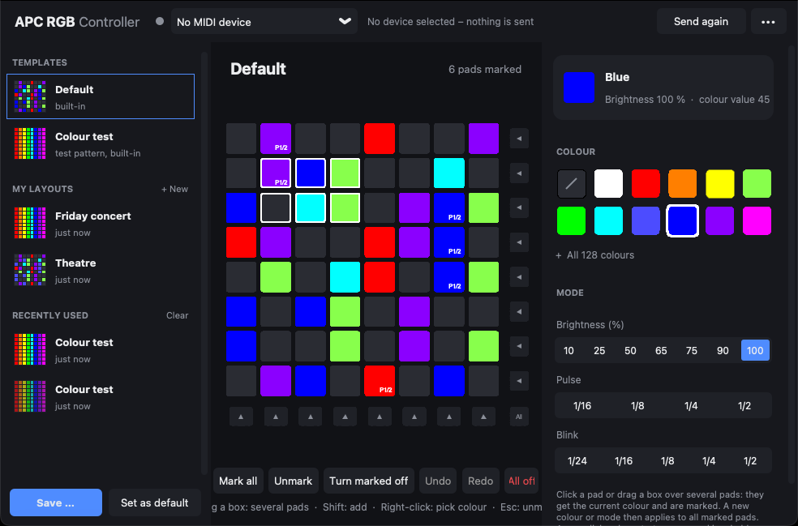

# APC RGB Controller

**English** · [Deutsch](README.de.md)

Set the colours of the 64 RGB pads of the **Akai APC mini mk2** – for example to colour-code the
controller to match your mapping in a lighting console such as **Obsidian Onyx**.
Version 2 with a new, simple interface.



The interface is available in English and German (follows the system language, can be switched in
the ••• menu).

## Download

Get the latest version from **[Releases](https://github.com/jonas-scl/akai-rgb-matrix-controller/releases/latest)** – no installation and no Python needed:

| System | Download | How to start |
| --- | --- | --- |
| Windows 10/11 | [APC-RGB-Controller-Windows.exe](https://github.com/jonas-scl/akai-rgb-matrix-controller/releases/latest/download/APC-RGB-Controller-Windows.exe) | Double-click. On first start Windows may warn you: “More info → Run anyway” (the program is not code-signed). |
| macOS with Apple Silicon (M1 or newer) | [APC-RGB-Controller-macOS-AppleSilicon.zip](https://github.com/jonas-scl/akai-rgb-matrix-controller/releases/latest/download/APC-RGB-Controller-macOS-AppleSilicon.zip) | Unzip, move the app to “Applications”, then **right-click → Open** (first time only, the app is not signed). |
| macOS with Intel processor | [APC-RGB-Controller-macOS-Intel.zip](https://github.com/jonas-scl/akai-rgb-matrix-controller/releases/latest/download/APC-RGB-Controller-macOS-Intel.zip) | same as above |

Not sure which Mac you have? Apple menu → *About This Mac*: “Chip: Apple M…” means Apple Silicon,
“Processor: … Intel …” means Intel.

If macOS says the app is “damaged”, run this once in the Terminal:

```bash
xattr -cr "/Applications/APC RGB Controller.app"
```

Your layouts and settings are kept when you replace the program with a newer version.

## How to use

* **Click a pad** → it gets the current colour and is marked (white outline).
* **Drag a selection box** → hold the mouse button and drag a frame over several pads (you can also
  start next to the grid): all pads inside are coloured and marked at once.
* A new click or box **starts a new marking**. Hold **Shift** (or Ctrl / ⌘) to add to the current
  one. Clicking an already marked pad unmarks it, clicking empty space or **Esc** unmarks everything.
* **Pick a colour** → all marked pads get that colour (their mode stays).
  **Pick a mode** → all marked pads get that mode (their colour stays).
* **Arrows on the right / at the bottom** colour a whole row / column, **“All”** the whole grid.
* **Right-click** a pad (Mac: Ctrl-click) to pick up its colour and mode (eyedropper).
* **Delete** turns the marked pads off. **Ctrl+Z / Ctrl+Y** (Mac: ⌘Z / ⌘⇧Z) – undo / redo.
* **“All 128 colours”** shows the complete 128-colour palette of the APC mini mk2.
* **Mode**: brightness 10–100 %, pulse or blink (1/24 … 1/2). The preview shows pads steadily; the
  mode is shown as a small badge on the pad (e.g. `50%`, `P1/4` = pulse, `B1/8` = blink).

### Layouts

In the sidebar on the left:

* **Default** – your own default layout. “Set as default” overwrites it with the current pads;
  right-click to reset it to the built-in version.
* **Colour test** – a fixed colour test pattern that cannot be overwritten.
* **My layouts** – layouts you saved with “Save …” (Ctrl+S). Right-click to overwrite, rename,
  export or delete.
* **Recently used** – the last 20 layouts are remembered automatically whenever you load another
  layout, turn everything off or close the program.

The ••• menu opens and exports `.midirgb` files (e.g. to share them).

### Autosave and behaviour on the device

* Every change is saved immediately – even after a crash everything is back on the next start.
* On start, the last saved state is **sent to the controller again in full**. The same happens when
  the controller is (re)connected while the program is running. Manually: “Send again” (Ctrl+R).
* **Nothing is sent when you close the program** – the controller keeps its colours as long as it
  has power.

### MIDI – what the program touches (and what it doesn't)

* Only **one single MIDI output** is opened: the one of the APC mini mk2 (detected automatically,
  otherwise choose it at the top). MIDI inputs and other devices are **never** opened, so Onyx
  can use the controller as usual. Choose **“No MIDI device”** to stop sending anything.
* Only Note-On messages for the 64 pads are sent (note 0–63; channel = brightness/mode,
  velocity = colour). No CC, no SysEx, no reset.
* On Windows a MIDI port can only be open in one program at a time. That's why the port is only
  opened briefly for sending and **released again about 1.5 s later** (can be turned off in the
  ••• menu). If another program keeps the output open, the status shows “Port busy” and the
  program retries every 2 seconds.

## File format `.midirgb`

JSON with note, colour value (velocity), channel (mode) and display colour for every pad.
**Files from version 1 can still be opened.**

```json
{"format": "midirgb", "version": 2, "name": "Show",
 "pads": [{"note": 0, "velocity": 5, "channel": 6, "hex": "#FF0000"}, …]}
```

All data is stored in the data folder (••• menu → “Open data folder”):

* Windows: `%APPDATA%\APC RGB Controller`
* macOS: `~/Library/Application Support/APC RGB Controller`

## Running from source

Requires **Python 3.8 – 3.12** (tested with 3.12). Python 3.13 and newer do not work because
`python-rtmidi` has no ready-made packages for them.

```bash
pip install -r requirements.txt
```

```bash
python main.py
```

Tests: `pip install -r requirements-build.txt`, then `python -m pytest`.

### Publishing a new version

1. Set the new version number in `apc_rgb/__init__.py` (e.g. `VERSION = "2.1.0"`) and push it.
2. Create and push a matching tag, e.g. `v2.1.0` (or create a release with that tag on GitHub).
3. GitHub Actions builds Windows and macOS versions, tests that they start and publishes them under
   Releases. The build stops if the tag does not match the version number.

## Project structure

```
main.py                 entry point
apc_rgb/app.py          main window
apc_rgb/matrix.py       8×8 grid
apc_rgb/midi.py         MIDI output (one port, Note-On only)
apc_rgb/layout.py       file format (v1 + v2)
apc_rgb/storage.py      autosave, default layout, library, history
apc_rgb/palette.py      128-colour table and modes
apc_rgb/i18n.py         interface texts (English / German)
apc_rgb/presets/        built-in layouts (Default, Colour test)
legacy/                 version 1 (original script)
tools/                  helpers for the build (screenshot, license notices)
.github/workflows/      builds for Windows and macOS
```

## License

Copyright © 2026 [jonas-scl](https://github.com/jonas-scl).
Licensed under the [PolyForm Shield License 1.0.0](LICENSE).

In short (the [LICENSE](LICENSE) text is what counts): you may **use the program for free, for any
purpose – including professionally** (e.g. at paid events), change it and pass it on. You may
**not** use it to offer a product that competes with it – for example selling it or a modified
version of it. The software comes as is, without any warranty or liability.

**Contributions:** by submitting a contribution (e.g. a pull request) you agree that the author may
use, change, relicense and sell it as part of this project.

Third-party components (Python, Tcl/Tk, python-rtmidi/RtMidi, CustomTkinter, …) keep their own
licenses, see [THIRD_PARTY_LICENSES.md](THIRD_PARTY_LICENSES.md).

*Akai, APC and APC mini are trademarks of their respective owners, as are Onyx and Obsidian. This
project is not affiliated with or endorsed by them.*
